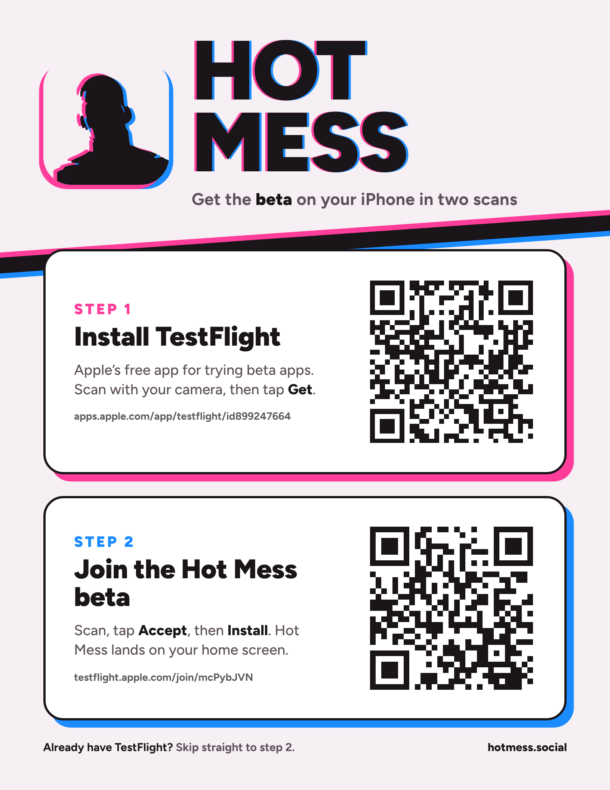

# TestFlight install poster

Letter-size (8.5x11 in) printable poster that walks people through installing the Hot Mess beta:

1. QR to install TestFlight: https://apps.apple.com/app/testflight/id899247664
2. QR to join the Hot Mess beta: https://testflight.apple.com/join/mcPybJVN

Print `hot-mess-testflight-poster.pdf` at actual size (no scaling).

## Editing

- `poster.tpl.html` is the source; `{{QR1}}`, `{{QR2}}` and `{{ICON}}` are filled in by `build.py`.
- `python3 build.py` (needs `segno`) writes `hot-mess-testflight-poster.html`.
- `node render.mjs` (needs `playwright`) writes the PDF and PNG preview. The page loads Figtree from Google Fonts, so render with network access.
- If the beta link changes, update `URL2` in `build.py` and the printed URL in the template, then rebuild and scan both codes before printing.
